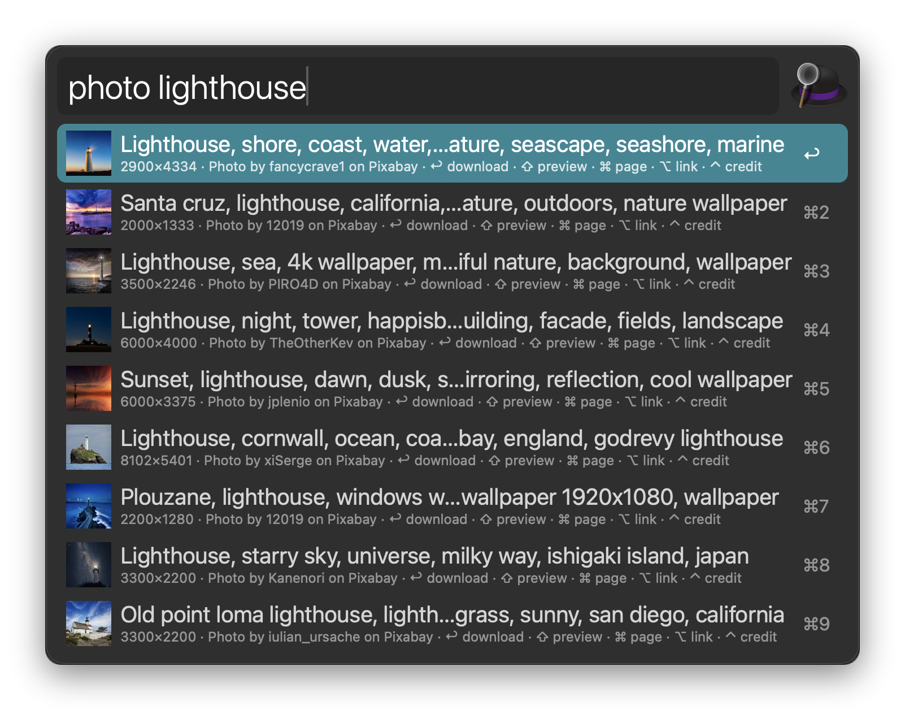

# Stock Photo Search

Search, preview and download royalty-free photos from [Pexels](https://www.pexels.com), [Pixabay](https://pixabay.com) and [Unsplash](https://unsplash.com).

## Usage

Search royalty-free photos on Pexels, Pixabay and Unsplash via the `photo` keyword.

* <kbd>↩</kbd> Download photo.
* <kbd>⌘</kbd><kbd>↩</kbd> Open photo page in the browser.
* <kbd>⌥</kbd><kbd>↩</kbd> Copy all details to the clipboard (title, photographer, source, size and link), ready to paste into notes or an email.
* <kbd>⌃</kbd><kbd>↩</kbd> Copy credit line.
* <kbd>⌘</kbd><kbd>Y</kbd> Quick Look photo (or tap <kbd>⇧</kbd>).

Prefix a search with `px:`, `pb:` or `us:` to use Pexels, Pixabay or Unsplash for that search only.

The default provider, download size and folder are set in the [Workflow’s Configuration](https://www.alfredapp.com/help/workflows/user-configuration/).

## Licenses

Photos from Pexels, Pixabay and Unsplash are free to use under their respective licenses ([Pexels](https://www.pexels.com/license/), [Pixabay](https://pixabay.com/service/license-summary/), [Unsplash](https://unsplash.com/license)). Attribution is not required but appreciated. Recognisable people, trademarks or artworks may be subject to additional rights.
