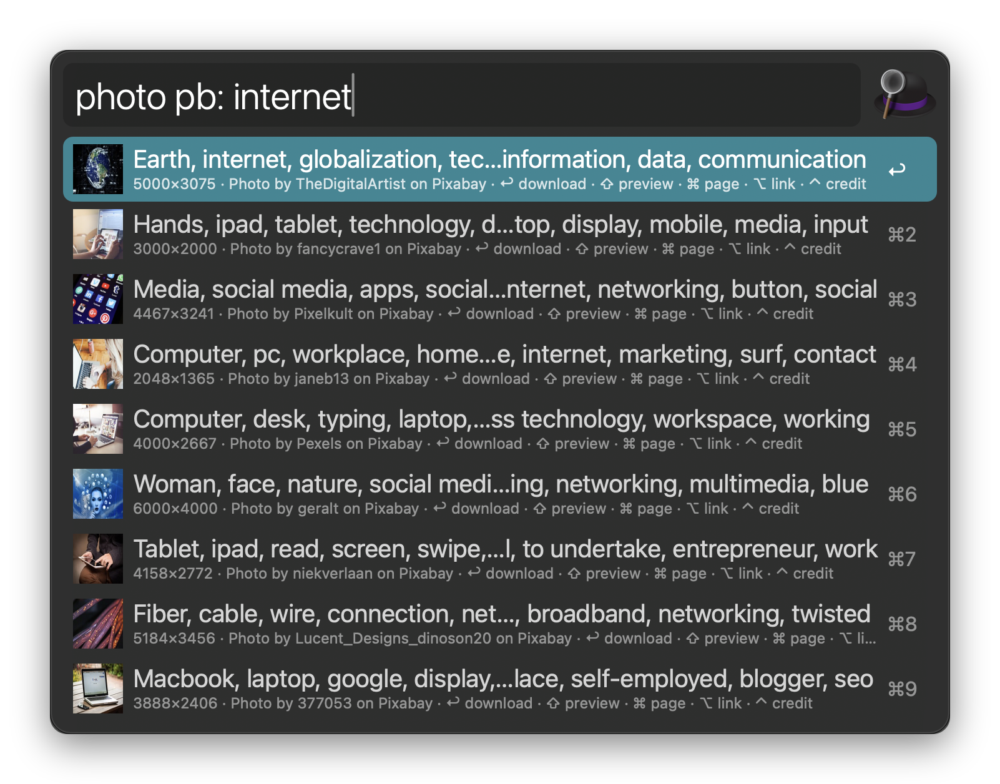

# Stock Photo Search

Search, preview and download royalty-free photos from [Pexels](https://www.pexels.com), [Pixabay](https://pixabay.com) and [Unsplash](https://unsplash.com).

## Usage

Search royalty-free photos via the `photo` keyword. Each result shows a thumbnail, the photographer and the image size. Press <kbd>⌥</kbd><kbd>↩</kbd> on a photo to put all its details on the clipboard at once, ready to paste into notes or an email.

* <kbd>↩</kbd> Download the photo.
* <kbd>⌘</kbd><kbd>↩</kbd> Open the photo page in the browser.
* <kbd>⌥</kbd><kbd>↩</kbd> Copy all important details to the clipboard: title, photographer, source, size and the link to the photo page.
* <kbd>⌃</kbd><kbd>↩</kbd> Copy the credit line.
* <kbd>⇧</kbd> or <kbd>⌘</kbd><kbd>Y</kbd> Quick Look a large preview of the photo.

Prefix a search with `px:`, `pb:` or `us:` to use Pexels, Pixabay or Unsplash for that search.

Configure the default provider, download size and folder, language (English or German) and cache duration in the [Workflow’s Configuration](https://www.alfredapp.com/help/workflows/user-configuration/).

## Licenses

Photos from Pexels, Pixabay and Unsplash are free to use under their respective licenses ([Pexels](https://www.pexels.com/license/), [Pixabay](https://pixabay.com/service/license-summary/), [Unsplash](https://unsplash.com/license)). Attribution is not required but appreciated. Recognisable people, trademarks or artworks may be subject to additional rights.
